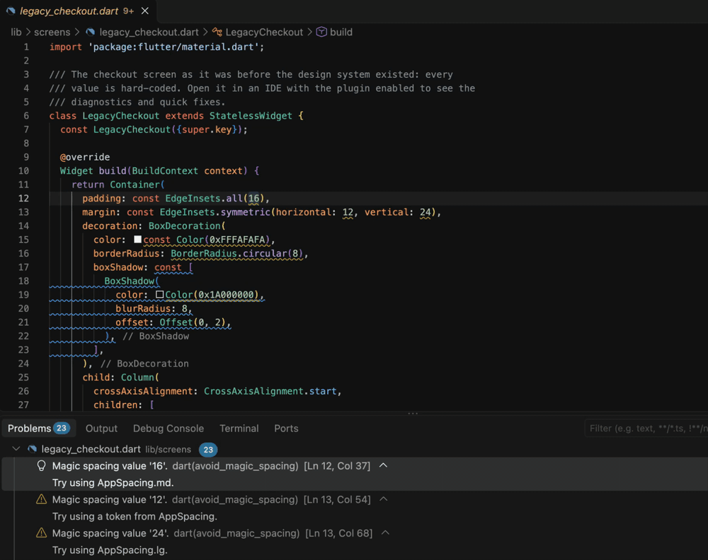

# design_token_lints

[](https://pub.dev/packages/design_token_lints)
[](https://github.com/AshitaNema/design_token_lints/actions/workflows/ci.yml)
[](https://codecov.io/gh/AshitaNema/design_token_lints)
[](LICENSE)

design_token_lints enforces *your* design system, not a generic style guide.
Point it at the token classes you already have and the components that replace
raw widgets; it flags raw colours, magic spacing, inline text styles and
hand-rolled radii and shadows in your IDE and in `dart analyze`, quick-fixes
them to the matching token, and `design_token_lints coverage` tells you how
much of your UI actually uses the system. Built on Dart's official analyzer
plugin system: no annotations, no codegen, no custom_lint. Inspired by Pat
O'Brien's [design_system_lints](https://pub.dev/packages/design_system_lints),
which pioneered design-system linting on the Sidecar framework.



Videos: [quick fixes in VS Code](doc/quick_fix.mp4) (49 s: a color, `Text` to `AppText`, an inline `TextStyle`, a radius and a button, with the import added each time), and a [terminal demo](doc/demo.mp4) of `dart analyze` and `design_token_lints coverage` on the example app, taking coverage from 43% to 90%.

## Set up in 30 seconds

1. Tell the analyzer to load the plugin, in the `analysis_options.yaml` at the
   root of your package (or workspace):

   ```yaml
   plugins:
     design_token_lints: ^0.1.0
   ```

2. Describe your design system. Add this to the same file, or to a
   `design_token_lints.yaml` next to `pubspec.yaml`:

   ```yaml
   design_token_lints:
     design_system:
       paths: [lib/design_system/**]
     tokens:
       color:   { class: AppColors,  file: lib/design_system/app_colors.dart }
       spacing: { class: AppSpacing, file: lib/design_system/app_spacing.dart }
   ```

3. Restart the Dart analysis server (in VS Code: *Dart: Restart Analysis
   Server*). Raw values in your code are now reported, with quick fixes.

Nothing is reported for a category until you configure its tokens, so you can
adopt one category at a time.

Install the plugin only through `analysis_options.yaml`, never as a dependency in
`pubspec.yaml`. The analysis server resolves plugins in its own package, so
adding it to `pubspec.yaml` would only add its analyzer constraint to your app.

## What it reports

| Rule | Severity | Flags |
| --- | --- | --- |
| [`avoid_raw_color`](#avoid_raw_color) | warning | `Color(0xFF…)`, `Color.fromARGB/fromRGBO/from`, `Colors.*` |
| [`avoid_magic_spacing`](#avoid_magic_spacing) | warning | numeric literals in `EdgeInsets`, `SizedBox`, `Gap` |
| [`avoid_raw_radius`](#avoid_raw_radius) | warning | `BorderRadius.circular(8)`, `Radius.circular(8)` |
| [`avoid_inline_text_style`](#avoid_inline_text_style) | warning | `TextStyle(...)` written by hand |
| [`avoid_raw_shadow`](#avoid_raw_shadow) | info | `BoxShadow(...)` and lists of them |
| [`prefer_design_system_component`](#prefer_design_system_component) | warning | raw widgets that have a replacement |

All rules are on by default. Every rule skips the design-system files, the
token files themselves, generated files, and anything you exclude.

To turn a rule off or change its severity, give the plugin entry a `version`
and a `diagnostics` section:

```yaml
plugins:
  design_token_lints:
    version: ^0.1.0
    diagnostics:
      avoid_raw_shadow: false
      avoid_magic_spacing: error
```

To silence one report:

```dart
// ignore: design_token_lints/avoid_raw_color
const legacyBlue = Color(0xFF123456);
```

`// ignore_for_file: design_token_lints/<rule>` silences a rule for a file.

## Configuration

The plugin framework has no per-rule options yet, so the plugin reads its own
configuration. It looks for, in this order:

1. `design_token_lints.yaml` next to `pubspec.yaml`, or
2. a top-level `design_token_lints:` section in `analysis_options.yaml` at the
   package root.

If both exist, the standalone file wins; they are not merged. The top-level
section is **not** inherited through `include:`, because it is read from the
package's own `analysis_options.yaml` only. In a pub workspace, a member
package without its own configuration uses the one at the workspace root.

The configuration is found from the package that contains the analyzed file,
cached per package, and reloaded when the configuration or a token file
changes. A malformed configuration never crashes the analyzer: the plugin
reports nothing, and `design_token_lints check-config` prints what is wrong.

```yaml
design_token_lints:
  # Files where raw values legitimately live. Globs are relative to the
  # directory that holds the configuration. The token files themselves are
  # always exempt.
  design_system:
    paths: [lib/design_system/**, lib/theme/**]
    packages: [acme_design_system]   # exempt by package name (workspaces)

  # Your existing token classes. A token is a `static const` member; no
  # annotations or code generation. `file` is a path relative to the
  # configuration, or a package: URI for tokens in a dependency.
  tokens:
    color:      { class: AppColors,     file: lib/design_system/app_colors.dart }
    spacing:    { class: AppSpacing,    file: lib/design_system/app_spacing.dart }
    radius:     { class: AppRadius,     file: lib/design_system/app_radius.dart }
    typography: { class: AppTypography, file: lib/design_system/app_typography.dart }
    shadow:     { class: AppShadows,    file: package:acme_design_system/shadows.dart }

  # Values that are always fine.
  allow:
    color: [Colors.transparent, 0xFF000000]   # Colors.<name> or an ARGB value
    spacing: [0, 2]                           # 0 is always allowed
    radius: [999]

  # When to offer "nearest token" fixes. 0 (the default) means exact only.
  matching:
    spacing_tolerance: 0     # logical pixels
    radius_tolerance: 0      # logical pixels
    color_delta_e: 2.0       # CIEDE2000; around 2 is "barely noticeable"

  # Raw widgets and what replaces them.
  components:
    ElevatedButton: { replacement: AppButton, import: package:acme_ui/acme_ui.dart }
    Text:           { replacement: AppText,   import: package:acme_ui/acme_ui.dart }

  # Files no rule applies to. Generated files (`*.g.dart`, `*.freezed.dart`,
  # and files with a "GENERATED CODE" header) are skipped without listing them.
  exclude: ["**/*.g.dart", "**/*.freezed.dart", "test/**"]

  # Exclusions for a single rule.
  rules:
    avoid_magic_spacing: { exclude: [lib/legacy/**] }
```

### How tokens are found

Each configured token file is parsed, without resolution and without a build
step, and every `static const` member of the configured class is evaluated
statically. These forms are understood:

- numbers, including arithmetic and references to other constants in the same
  class or file (`static const lg = md * 1.5;`);
- `Color(0xAARRGGBB)`, `Color.fromARGB`, `Color.fromRGBO`, `Color.from`, and
  `Colors.*`;
- `Radius.circular`, `BorderRadius.circular`, `BorderRadius.all(Radius.circular(…))`;
- `TextStyle(fontSize:, fontWeight:, height:, letterSpacing:)`;
- `BoxShadow(...)` and lists of them, with `Offset(dx, dy)`.

Members that cannot be evaluated (computed values, `static final`, getters) are
skipped. `design_token_lints check-config` lists them.

## Rules

### avoid_raw_color

Flags `Color(0xFF…)`, `Color.fromARGB`, `Color.fromRGBO`, `Color.from`, and
`Colors.<name>`, including `Colors.red.shade100` and `Colors.red[100]`, unless
allow-listed. `Colors` must be Flutter's class; your own `Colors` is ignored.
Allowed: `AppColors.primary`, `Theme.of(context).colorScheme.primary`.

```dart
// Bad
Container(color: const Color(0xFF1E88E5))

// Good
Container(color: AppColors.primary)
```

**Fix.** An exact ARGB match offers *Replace with AppColors.primary*. When a
token has the same value as another (an alias), both are offered. With
`matching.color_delta_e` set, close colors also offer *Replace with nearest
token AppColors.primary (ΔE 1.3)*, at lower priority, up to three candidates.
A color with a different alpha is never a match.

### avoid_magic_spacing

Flags numeric literals in `EdgeInsets.all/symmetric/only/fromLTRB`,
`EdgeInsetsDirectional.*`, `SizedBox(width:, height:)`, `SizedBox.square`, and
`Gap` / `SliverGap`. `0`, values in `allow.spacing`, negative numbers and
non-literal expressions are ignored.

```dart
// Bad
Padding(padding: const EdgeInsets.all(16))

// Good
Padding(padding: const EdgeInsets.all(AppSpacing.md))
```

**Fix.** *Replace 16 with AppSpacing.md.* Within `matching.spacing_tolerance`,
*Replace 15 with nearest token AppSpacing.md (Δ1)*. Tokens at the same distance
are all offered.

### avoid_raw_radius

Flags `BorderRadius.circular(n)`, `BorderRadius.all(Radius.circular(n))`,
`Radius.circular(n)`, and each corner of `BorderRadius.only/vertical/horizontal`.

```dart
// Bad
BorderRadius.circular(8)

// Good
BorderRadius.circular(AppRadius.md)   // a double token
AppRadius.card                        // a BorderRadius token
```

**Fix.** The surrounding constructor is kept when the token is a `double`, and
the whole expression is replaced when the token is a `Radius` or
`BorderRadius`. Nearest matches use `matching.radius_tolerance`.

### avoid_inline_text_style

Flags `TextStyle(...)` written outside the design system, including inside
`Text(style:)` and `DefaultTextStyle`. Allowed: `AppTypography.body`,
`Theme.of(context).textTheme.bodyMedium`, and `.copyWith(color: …)` on a token.

```dart
// Bad
Text('Total', style: TextStyle(fontSize: 22, fontWeight: FontWeight.bold))

// Good
Text('Total', style: AppTypography.title)
```

**Fix.** Offered only when `fontSize` and `fontWeight` (and `height` and
`letterSpacing`, which must agree in both directions) exactly match one token.
If the style also sets `color`, the fix is
`AppTypography.title.copyWith(color: …)`, except in a `const` context, where no
fix is offered. Any other argument (`fontFamily`, `decoration`, …) means no fix.

### avoid_raw_shadow

Severity: **info**. Flags `BoxShadow(...)` and `List<BoxShadow>` literals. A list
is reported once, not per element.

```dart
// Bad
BoxDecoration(boxShadow: [BoxShadow(color: Color(0x1A000000), blurRadius: 8)])

// Good
BoxDecoration(boxShadow: AppShadows.card)
```

**Fix.** Only on an exact structural match with a shadow token (same layers,
colors, blur, spread and offset).

### prefer_design_system_component

Flags construction of a Flutter widget listed under `components:`. The widget is
matched through its resolved element, so your own `Text` class is never
reported.

```dart
// Bad
ElevatedButton(onPressed: save, child: Text('Save'))

// Good
AppButton(onPressed: save, child: AppText('Save'))
```

**Fix.** *Replace ElevatedButton with AppButton*: the class name is renamed, the
constructor name and the arguments are kept, and the configured `import` is
added (or reused, including an existing prefixed import). The fix only renames;
making the arguments compatible with the replacement is up to you.

## Coverage

```sh
dart pub global activate design_token_lints
design_token_lints coverage
```

```text
Design system coverage: 42% (colors 25%, spacing 42%, radius 33%, typography 50%, shadows 50%, components 50%) — 7 magic spacing values in 1 file
```

Coverage of a category is `token uses / (token uses + raw values)`. A token use
is a reference to a static member of a configured token class (or a use of a
configured replacement widget); a raw value is what the rules above report. The
overall figure weights every use and every raw value equally. It runs the same
detectors as the plugin, so the numbers match what the IDE shows.

Install the command line tool globally, not as a dev dependency. A dev
dependency would add the analyzer's version constraints to your project.

```text
design_token_lints coverage [path] [--format console|json|markdown]
                            [--output file] [--fail-under 80]
                            [--category color,spacing,radius,typography,shadow,component]
design_token_lints check-config [path]
```

| Option | Meaning |
| --- | --- |
| `--format` | `console` (default), `json` (with `"schemaVersion": 1`), or `markdown` |
| `--output` | write the report to a file; a one-line summary goes to the console |
| `--fail-under N` | exit with code 1 if overall coverage is below N percent |
| `--category` | measure only these categories |

Exit codes: `0` success, `1` coverage below `--fail-under`, `2` usage or
configuration error. `check-config` validates the configuration and prints
every token it found and every member it skipped.

The JSON report has `totals`, per-`categories` statistics, per-`rules` counts,
and `files` with each finding's `line`, `column`, `rule`, `message` and
`suggestedToken`.

### In CI

This GitHub Actions job keeps one "sticky" comment on each pull request up to
date, and fails the build below 80%:

```yaml
name: Design system coverage
on: pull_request

permissions:
  contents: read
  pull-requests: write

jobs:
  coverage:
    runs-on: ubuntu-latest
    steps:
      - uses: actions/checkout@v4
      - uses: subosito/flutter-action@v2
      - run: flutter pub get
      - run: dart pub global activate design_token_lints
      - name: Measure coverage
        id: coverage
        run: |
          set +e
          design_token_lints coverage --format markdown --output coverage.md --fail-under 80
          echo "status=$?" >> "$GITHUB_OUTPUT"
      - uses: marocchino/sticky-pull-request-comment@v2
        with:
          header: design-token-lints
          path: coverage.md
      - name: Enforce the threshold
        if: steps.coverage.outputs.status != '0'
        run: exit ${{ steps.coverage.outputs.status }}
```

Run the plugin's diagnostics in CI with `dart analyze`:

```yaml
- run: dart analyze
```

## Limitations

- **Restart the analysis server** after you edit the `plugins:` section of
  `analysis_options.yaml`. Changes to the `design_token_lints` configuration and
  to token files need no restart: they are picked up the next time a file is
  analyzed, so touch (or reopen) a file to see them.
- **Plugins are configured at the root only.** Declare the plugin in the
  `analysis_options.yaml` at the package or workspace root; the analyzer ignores
  plugin declarations in nested options files.
- **The `design_token_lints:` section is not inherited through `include:`.** Put
  it in the package's own `analysis_options.yaml`, or use
  `design_token_lints.yaml`.
- **Use `dart analyze`, not `flutter analyze`, in CI.** `flutter analyze` does
  not report this plugin's diagnostics.
- **Workspaces.** The plugin keeps a small configuration and token cache for each
  configuration root. In a large workspace, give packages that share a design
  system one configuration at the workspace root rather than one each.
- **Names are matched, not resolved, for constructors.** `EdgeInsets`,
  `SizedBox`, `Gap`, `BorderRadius`, `Radius`, `TextStyle`, `BoxShadow` and
  `Color` are recognized by name, so a class of your own with one of those
  names and constructor shapes is treated the same way. `Colors` and the
  classes under `components:` are checked through the resolved element.
- **Tokens must be constant.** `static final` members, getters and values that
  need runtime evaluation (`ThemeExtension` tokens) are not read.
- **Quick fixes are applied one at a time.** The analysis server does not apply
  plugin fixes in bulk (`dart fix`).

## How this compares

Each of these is a good tool; they answer different questions. This table only
states what the packages describe about themselves.

| Package | Focus | Built on |
| --- | --- | --- |
| design_token_lints | Your own design tokens and components: flag, fix, and measure adoption | Analyzer plugin |
| [design_system_lints](https://pub.dev/packages/design_system_lints) | Lints and code edits for UI standards in a codebase | Sidecar |
| [clean_code_lints](https://pub.dev/packages/clean_code_lints) | Clean architecture and clean code rules | Analyzer plugin |
| [altive_lints](https://pub.dev/packages/altive_lints) | A recommended rule selection, with optional analyzer plugin integration | Lint presets and analyzer plugin |
| [many_lints](https://pub.dev/packages/many_lints) | A broad collection of Flutter and Dart rules, fixes and assists | Analyzer plugin |
| [house_rules](https://pub.dev/packages/house_rules) | Project rules written in YAML: design tokens, layering, widgets, state management | YAML-defined rules |
| [DCM](https://dcm.dev) `banned-usage` | A commercial code-quality tool; ban configured usages | DCM |

If you want rules that are about *your* token classes, with fixes that insert
*your* constants and a coverage number to track, this package is aimed at that.
If you want a general rule set, one of the others is a better start. They
combine well, since plugins live side by side in `analysis_options.yaml`.

## Roadmap

Not in 0.1.0, in no particular order:

- opacity and `withValues` handling;
- icon-size and elevation tokens;
- `ThemeExtension`-based tokens;
- importing tokens from Figma, Tokens Studio and the W3C design tokens format;
- a baseline file for gradual adoption;
- SARIF output for the coverage command;
- bulk application of fixes (`dart fix`), if and when plugin fixes support it;
- per-rule options in `analysis_options.yaml`, once the SDK supports options
  for plugins (dart-lang/sdk#63099 or a successor).

## Credits

- [design_system_lints](https://pub.dev/packages/design_system_lints) by Pat
  O'Brien, for showing that a design system can be linted.
- [many_lints](https://pub.dev/packages/many_lints), whose approach of reading a
  configuration file from the package root this package follows.
- The Dart team's `analysis_server_plugin` and `analyzer_testing` packages.
- The CIEDE2000 implementation is checked against the reference data of Sharma,
  Wu and Dalal, *The CIEDE2000 Color-Difference Formula* (2005).

Licensed under the [MIT License](LICENSE).
